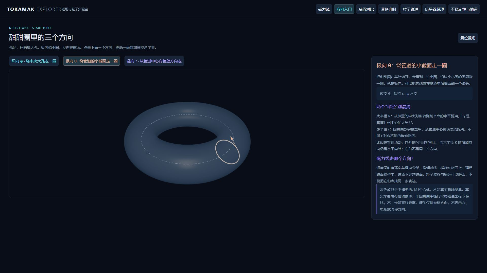

# Tokamak Explorer

在浏览器中探索托卡马克磁力线、粒子轨道、漂移、不稳定性与输运的交互式教学工作台。

使用 React、TypeScript、Vite、Three.js、React Three Fiber、Drei、Tailwind CSS 和 Vitest。所有计算在本地浏览器运行，无需后端或付费 API。



## 本地运行

建议使用 Node.js 24 和 pnpm（与 GitHub Actions 保持一致）。

```sh
pnpm install --frozen-lockfile
pnpm dev
```

打开终端输出的本地地址，默认是 `http://127.0.0.1:5173/`。

```sh
pnpm test
pnpm typecheck
pnpm build
```

构建结果位于 `dist/`，可部署到静态网站托管服务。也可使用 npm 安装依赖并执行同名脚本；仓库维护的是 `pnpm-lock.yaml`。

## 七个探索页面

| 页面 | 可以观察什么 |
| --- | --- |
| 磁力线 | 精确分数 q、符号无理数与普通数值输入；单线、多线、磁面；同步 R–Z 与 Poincaré 截面 |
| 方向入门 | 环向绕大孔、极向绕小圈、径向穿磁面；彩色路径、方向箭头与 R/r 区别 |
| 装置对比 | 同一米制比例下比较 28 台装置：22 台托卡马克、6 台仿星器/螺旋装置；搜索、筛选与公开参数来源 |
| 漂移机制 | ∇B、曲率及 E×B 漂移；场方向、正负试验电荷对照、真实位移与可旋转的空间示意 |
| 粒子轨道 | 数值导引中心积分生成通行与香蕉轨道；同步 R–Z 投影、平行速度、反弹次数与守恒误差 |
| 仿星器原理 | 两类位形并排、独立旋转；旋转变换、径向漂移投影、平均漂移优化，以及电流与稳态运行的区别 |
| 不稳定性与输运 | Kink、Tearing、Ballooning、ELM、锯齿、RWM、ITG、TEM、ETG 和扩散；旁栏原理、公式、模型限制与外部推导链接 |

不稳定性分类表明确标注**宏观、微观或跨尺度**，并分别说明尺度、驱动与物理模型。MTM、KBM 目前提供分类参考，尚无独立动画。ELM 是边缘弛豫事件；常见 I 型 ELM 的 peeling–ballooning 解释不代表所有 ELM 类型。

磁力线页另有 EAST、ITER、SPARC、JET、ASDEX Upgrade、KSTAR、JT-60SA 七个几何预设，切换装置不会修改 q。

## 演化时长与操作

**演化时长决定模拟到多晚，不是把同一段动画放慢。** 延长区间后，轨迹继续延伸、粒子重新积分到更晚时刻，或显示更多归一化演化周期。进度条用于定位当前区间中的时刻。

| 页面 | 演化区间 | 固定推进速率 |
| --- | --- | --- |
| 磁力线 | 1–100 示意秒，对应同数环向圈 | 1 圈/播放秒；不代表粒子真实飞行时间 |
| 漂移机制 | 1–120 μs | 8/6 μs/播放秒 |
| 粒子轨道 | 10–250 μs，实际积分区间 | 30 μs/播放秒 |
| 仿星器原理 | 0.5–4 T | 1 T/6 播放秒 |
| 不稳定性与输运 | 0.5–4 T | 1 T/10 播放秒 |

这里 T 是任意教学时间单位，不是秒或磁场单位特斯拉。不保证扰动无限增长：部分形变按规定在 1T 后饱和，ELM/锯齿按预设周期反复，RWM 缓慢趋于饱和。

- 三维场景支持拖动旋转、滚轮缩放；磁力线页还提供平移、预设相机与双击聚焦。
- 几何参数支持滑块和数值输入；非法几何保留上一有效场景。
- 调整磁力线参数或粒子积分区间后会归零暂停，点击播放或重播即可观察新轨迹。
- Poincaré 每完成一圈环向记录一次，不计起点；记录次数不等于不同位置数。有理面的重合点会叠加。

## 物理模型与适用范围

磁力线教学模型使用直磁力线角关系：

```text
θ(φ) = θ₀ + φ/q
r = ρa, α = asin(δ)
R = R₀ + r cos(θ + α sin θ)
Z = κr sin θ
x = R cos φ, y = R sin φ, z = Z
```

精确指定 q=m/n 后先约分，最小闭合周期为 m 圈环向、n 圈极向。√2、π 保留符号类型；普通小数输入始终标为 Numeric / Undetermined，不根据浮点误差宣判有理性。非圆截面的几何极向角近似等同直磁力线角，**不是 Grad–Shafranov、EFIT 或 VMEC 的真实平衡解**。

参考磁面不是工程真空室，几何中心不等于实测磁轴。装置目录表示公开设计或特定工况的几何近似；仿星器外形为通用三维示意，不是各装置真实边界或线圈 CAD。

粒子页采用固定圆截面、轴对称场的一阶导引中心模型，平均掉快速回旋；未包括碰撞、电场、湍流与真实平衡。漂移机制页是纯环向场中的机制分解，与完整约束轨道积分分开。

仿星器与托卡马克都利用旋转变换。仿星器优化追求较小的轨道/反弹平均径向漂移，而非消除所有局部漂移。并排动画使用同一人为参考漂移，左侧默认显示 ×50、右侧 ×1，可恢复同倍率；**显示倍率不代表真实装置性能差距**。

不稳定性、磁岛轮廓、波纹与扩散云均为规定的教学形状或分布，不求解真实 MHD、重联、回旋动理学或湍流，不预测增长率、稳定阈值、损失率或 ELM 热负荷。

## 源代码与后续扩展

| 位置 | 用途 |
| --- | --- |
| `src/api.ts` | 现有数学、装置数据与粒子模型的公共入口 |
| `src/model.ts`、`src/surface.ts` | 磁力线与参数化磁面几何 |
| `src/presets.ts`、`src/devices.ts` | 几何预设、装置目录及来源元数据 |
| `src/particles.ts`、`src/stellarator.ts` | 导引中心、漂移与仿星器教学模型 |
| `src/instability.ts`、`src/microinstability.ts`、`src/extraInstabilities.ts` | 教学形变、波纹与弛豫周期 |
| `src/Scene.tsx`、`src/Torus.tsx` | 三维场景与共享曲面 |
| `src/Experiments.tsx` 及各实验组件 | 页面与交互 |

扩展约定见 [EXTENDING.md](EXTENDING.md)。模型与视图分离，后续接入真实平衡数据时应替换磁场及其导数，并重新验证坐标、轨道守恒与模型适用性。

参数及模型依据：[SOURCES.md](SOURCES.md)、[DEVICES.md](DEVICES.md)、[PARTICLES.md](PARTICLES.md)。开发完成记录见 [PROGRESS.md](PROGRESS.md)。

## 验证与当前限制

截至 2026-10-20，43 项 Vitest 测试通过，TypeScript 检查与生产构建通过。测试覆盖有理闭合、符号类型、几何与截面一致性、漂移方向、轨道守恒、演化区间延长，以及规定形变与弛豫周期。GitHub Actions 在 push / pull request 时执行测试、类型检查和构建。

浏览器已实际检查主要场景、方向切换、装置切换、进度与时间控制。截图位于 [screenshots/](screenshots/)，详细记录见 [QA.md](QA.md)。

每条磁力线限制 60,000 段，多线最多三条；三维模块延迟加载。生产构建仍有 Three.js 大分块提示，尚未做显卡性能基准、触屏实机验证或完整自动化浏览器回归。尚无图表 PNG 导出、参数分享与真实平衡数据导入。
