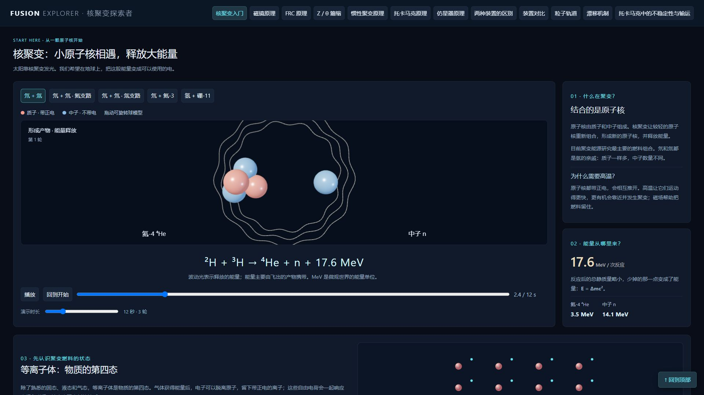

# 核聚变探索者 · Fusion Explorer

Vibe-coded by Chang Huayi with Codex

从原子核相遇开始，在浏览器中探索核聚变和等离子体：磁镜、FRC、Z/θ箍缩、惯性约束聚变、托卡马克与仿星器，以及磁力线、粒子轨道、漂移、不稳定性和输运。面向初学者的交互式三维教学工作台。

**[在线体验核聚变探索者](https://fusion-explorer.surebell1025.chatgpt.site)** · 公开访问，链接可直接分享。

项目原名 Tokamak Explorer，现已扩展为涵盖多种聚变路线的 Fusion Explorer。公开网页地址已改为 fusion-explorer。

使用 React、TypeScript、Vite、Three.js、React Three Fiber、Drei、Tailwind CSS 和 Vitest。所有计算在本地浏览器运行，无需后端或付费 API。



## 本地运行

建议使用 Node.js 24 和 pnpm（与 GitHub Actions 保持一致）。

```sh
pnpm install --frozen-lockfile
pnpm dev
```

打开终端输出的本地地址，默认是 `http://127.0.0.1:5173/`。

```sh
pnpm test
pnpm typecheck
pnpm build
```

构建结果位于 `dist/`，可部署到静态网站托管服务。也可使用 npm 安装依赖并执行同名脚本；仓库维护的是 `pnpm-lock.yaml`。

## 十三个探索页面

| 页面 | 可以观察什么 |
| --- | --- |
| 核聚变入门 | 五种反应球模型与方程（含氢硼）、波动能量光、电离滑块、常见等离子体及空气密度对比 |
| 磁镜原理 | 两端强磁场、反弹与端部漏失；可调磁镜比、出发夹角及漏失锥判据 |
| FRC 原理 | 核心磁场反向、内部闭合磁力线、外部开放磁力线与零磁场环 |
| Z / θ 箍缩 | 并排比较轴向/绕柱电流与磁场方向，以及向内压缩 |
| 惯性聚变原理 | 直接/间接驱动切换，外层烧蚀、燃料压缩、燃烧及膨胀过程 |
| 托卡马克原理 | 装置构成、可隐藏的环向/极向场线圈及中央螺线管；m/n 入门；可旋转切片与同步 R–Z / 庞加莱点图 |
| 仿星器原理 | 三维主线圈显隐与透明度、扭转曲面、可选切片及同步截面图；与第一页一致的操作方式 |
| 两种装置的区别 | 大电流与外部线圈的不同作用，通行/被俘获粒子直觉，位形与人为参考漂移的并排示意 |
| 装置尺寸对比 | 同一米制比例下比较28台装置；悬停三维模型显示名称，默认展开建造/使用时间、功率及来源 |
| 进阶探索 | 一次放电、合成诊断、电场与电流、加热与电流驱动、磁平衡与剖面、刮削层与偏滤器 |
| 粒子轨道 | 数值导引中心积分生成通行/香蕉轨道，同步 R–Z、平行速度与守恒误差 |
| 漂移机制 | ∇B、曲率及 E×B 漂移，场方向、真实位移与可旋转空间示意 |
| 托卡马克中的不稳定性与输运 | 宏观/微观例子、分类、简要原理及外部推导链接 |

不稳定性分类表明确标注**宏观、微观或跨尺度**，并分别说明尺度、驱动与物理模型。MTM、KBM 目前提供分类参考，尚无独立动画。ELM 是边缘弛豫事件；常见 I 型 ELM 的 peeling–ballooning 解释不代表所有 ELM 类型。

原有高级磁力线组件保留在源码，当前导航优先展示原理入门；该组件另有 EAST、ITER、SPARC、JET、ASDEX Upgrade、KSTAR、JT-60SA 七个几何预设，切换装置不会修改 q。

## 演化时长与操作

**演化时长决定模拟到多晚，不是把同一段动画放慢。** 延长区间后，轨迹继续延伸、粒子重新积分到更晚时刻，或显示更多归一化演化周期。进度条用于定位当前区间中的时刻。

| 页面 | 演化区间 | 固定推进速率 |
| --- | --- | --- |
| 磁力线 | 1–100 示意秒，对应同数环向圈 | 1 圈/播放秒；不代表粒子真实飞行时间 |
| 漂移机制 | 1–120 μs | 8/6 μs/播放秒 |
| 进阶探索 | 一次放电、合成诊断、电场与电流、加热与电流驱动、磁平衡与剖面、刮削层与偏滤器 |
| 粒子轨道 | 10–250 μs，实际积分区间 | 30 μs/播放秒 |
| 两种装置的区别 | 0.5–4 T | 1 T/6 播放秒 |
| 不稳定性与输运 | 0.5–4 T | 1 T/10 播放秒 |

这里 T 是任意教学时间单位，不是秒或磁场单位特斯拉。不保证扰动无限增长：部分形变按规定在 1T 后饱和，ELM/锯齿按预设周期反复，RWM 缓慢趋于饱和。

- 三维场景支持拖动旋转、滚轮缩放；磁力线页还提供平移、预设相机与双击聚焦。
- 几何参数支持滑块和数值输入；非法几何保留上一有效场景。
- 调整磁力线参数或粒子积分区间后会归零暂停，点击播放或重播即可观察新轨迹。
- Poincaré 每完成一圈环向记录一次，不计起点；记录次数不等于不同位置数。有理面的重合点会叠加。

## 物理模型与适用范围

磁力线教学模型使用直磁力线角关系：

```text
θ(φ) = θ₀ + φ/q
r = ρa, α = asin(δ)
R = R₀ + r cos(θ + α sin θ)
Z = κr sin θ
x = R cos φ, y = R sin φ, z = Z
```

精确指定 q=m/n 后先约分，最小闭合周期为 m 圈环向、n 圈极向。√2、π 保留符号类型；普通小数输入始终标为 Numeric / Undetermined，不根据浮点误差宣判有理性。非圆截面的几何极向角近似等同直磁力线角，**不是 Grad–Shafranov、EFIT 或 VMEC 的真实平衡解**。

参考磁面不是工程真空室，几何中心不等于实测磁轴。装置目录表示公开设计或特定工况的几何近似；仿星器外形为通用三维示意，不是各装置真实边界或线圈 CAD。

粒子页采用固定圆截面、轴对称场的一阶导引中心模型，平均掉快速回旋；未包括碰撞、电场、湍流与真实平衡。漂移机制页是纯环向场中的机制分解，与完整约束轨道积分分开。

仿星器与托卡马克都利用旋转变换。仿星器优化追求较小的轨道/反弹平均径向漂移，而非消除所有局部漂移。并排动画使用同一人为参考漂移，左侧默认显示 ×50、右侧 ×1，可恢复同倍率；**显示倍率不代表真实装置性能差距**。

不稳定性、磁岛轮廓、波纹与扩散云均为规定的教学形状或分布，不求解真实 MHD、重联、回旋动理学或湍流，不预测增长率、稳定阈值、损失率或 ELM 热负荷。

## 源代码与后续扩展

| 位置 | 用途 |
| --- | --- |
| `src/api.ts` | 现有数学、装置数据与粒子模型的公共入口 |
| `src/model.ts`、`src/surface.ts` | 磁力线与参数化磁面几何 |
| `src/presets.ts`、`src/devices.ts` | 几何预设、装置目录及来源元数据 |
| `src/deviceFacts.ts` | 28台装置的建造/运行时间、分类型功率、工况及公开来源 |
| `src/particles.ts`、`src/stellarator.ts` | 导引中心、漂移与仿星器教学模型 |
| `src/instability.ts`、`src/microinstability.ts`、`src/extraInstabilities.ts` | 教学形变、波纹与弛豫周期 |
| `src/Scene.tsx`、`src/Torus.tsx` | 三维场景与共享曲面 |
| `src/Experiments.tsx` 及各实验组件 | 页面与交互 |

扩展约定见 [EXTENDING.md](EXTENDING.md)。模型与视图分离，后续接入真实平衡数据时应替换磁场及其导数，并重新验证坐标、轨道守恒与模型适用性。

参数及模型依据：[SOURCES.md](SOURCES.md)、[DEVICES.md](DEVICES.md)、[PARTICLES.md](PARTICLES.md)。开发完成记录见 [PROGRESS.md](PROGRESS.md)。

## 验证与当前限制

截至 2026-10-20，43 项 Vitest 测试通过，TypeScript 检查与生产构建通过。测试覆盖有理闭合、符号类型、几何与截面一致性、漂移方向、轨道守恒、演化区间延长，以及规定形变与弛豫周期。GitHub Actions 在 push / pull request 时执行测试、类型检查和构建。

浏览器已实际检查主要场景、方向切换、装置切换、进度与时间控制。截图位于 [screenshots/](screenshots/)，详细记录见 [QA.md](QA.md)。

每条磁力线限制 60,000 段，多线最多三条；三维模块延迟加载。生产构建仍有 Three.js 大分块提示，尚未做显卡性能基准、触屏实机验证或完整自动化浏览器回归。尚无图表 PNG 导出、参数分享与真实平衡数据导入。

前两页线圈仅是构成与功能示意，不由线圈计算磁场。仿星器的主线圈形状与数量不是某一真实装置 CAD。切片为固定 φ 的竖直半平面；庞加莱点包含首次到达切片及精确末端的记录，重合点叠加。

托卡马克与仿星器原理页追踪大圈数使用 1–200 圈滑块。切片角度控制和仿星器形状快捷按钮位于 R–Z 图卡片内，可同步查看三维切片与庞加莱记录。

## 核聚变开篇与资料

默认进入“核聚变入门”。球模型展示氘氚、氘氘两支路、氘—氦-3 和氢—硼-11 反应，质子为珊瑚色，中子为蓝色。氢硼反应生成三个氦-4 核，共释放约8.7 MeV，未把产物能量误标为固定等分。四秒展示一轮；演示时长 4–40 秒会增加反应轮数。支持暂停、回放和拖动进度。能量波纹是视觉表达，能量主要由产物动能携带。所有栏目共享顶部固定目录和右下角回顶按钮。

等离子体部分支持电离比例和燃料离子密度调节。默认离子密度 10²⁰ m⁻³，等份氘氚质量密度约 0.42 mg/m³；293 K、1 atm 空气约 1.2 kg/m³。数量比较为空气分子对燃料离子，约25万倍；质量比较约290万倍。

- [UKAEA PROCESS：反应及能量](https://ukaea.github.io/PROCESS/physics-models/fusion_reactions/plasma_reactions/)
- [ITER：实现聚变](https://www.iter.org/fusion-energy/making-it-work)
- [MIT：什么是等离子体](https://www.psfc.mit.edu/resources/fusion-101/what-is-plasma/)
- [IPP：W7-X 参考尺寸](https://www.ipp.mpg.de/16931/einfuehrung)及[真实线圈图](https://www.ipp.mpg.de/1471940/wendelstein_7_x)

仿星器原理页按 5.5 m / 0.53 m 参考尺寸改成纤细、孔洞开阔的环体，25组示意线圈呈五重重复；模型标记为 W7-X 风格，仍可逐层隐藏与选择切片。

## 物态温度—密度图

等离子体介绍以“物质的第四态”开篇。取消独立的生活例子卡片，在同一张双对数图中展示固态、液态、气态及等离子体的常见跨度；温度统一为 K，横轴用冷蓝到暖红的色带。十个可点节点包括金属、液态水、空气、日常火焰、霓虹灯、闪电热通道、太阳核心、空间等离子体、磁约束燃料及激光聚变热点。各节点附小图、温度、质量密度及来源；金属、水与太阳核心标签放在图上方，通过引线定位。

霓虹灯取电子温度，填充气体近室温；普通烛焰作为含少量电离成分的热气体对照。闪电密度采用1 atm热空气数量级估算，霓虹灯按600 Pa氖气示例，其他节点的代表条件在各自资料中说明。色块是常见范围示意。

稀薄程度用同粒子数的体积直观展示：默认空气1 mL对应燃料约250 L；可拖动燃料密度，三维方块体积、数值与图中燃料节点联动。方块边长按体积比的立方根计算。

[物态跨度图截图](screenshots/matter-temperature-density.jpg) · [体积对比截图](screenshots/plasma-density-volumes.jpg)

开篇首屏采用等高双栏；高温条件解释并入核聚变说明，减少独立卡片与空白。

## 在线发布与后续修改

Sites入口：https://fusion-explorer.surebell1025.chatgpt.site 。已按所有者要求开放为公开访问，拿到链接即可浏览。网站与私有GitHub仓库独立，源码继续保存在 Philbert1999/fusion-explorer；发布后仍可修改。修改后重新运行测试与构建，再发布同一个Sites项目即可更新内容。托管标识保存在 `.openai/hosting.json`，不含凭据。香港镜像计划使用阿里云OSS中国香港地域及核聚变相关自定义域名，尚未开通。

## 其他约束思路：三个问题

新增四页均按“靠什么约束燃料、粒子怎么运动、主要难点是什么”展开，并附旋转缩放、复位、暂停、进度与6–60演示秒时长控制。时长增加会延长运动或增加脉冲轮次，不改变播放速度。磁镜粒子轨迹与压缩过程是教学动画；FRC青线是解析示意磁通的闭合等值线，亮点标方向。磁镜使用磁矩近似下的漏失锥条件 sin²α > 1/Rm。

- [LLNL：磁镜原理及漏失锥](https://www.llnl.gov/sites/www/files/2020-06/mftf_etr_nov_86.pdf)
- [Scientific Reports：FRC磁场拓扑实验](https://pmc.ncbi.nlm.nih.gov/articles/PMC5814458/)
- [UT Austin：Z/θ线性箍缩](https://farside.ph.utexas.edu/teaching/plasma1/Fusionhtml/node11.html)
- [LLNL：惯性约束，直接/间接驱动](https://heds-center.llnl.gov/research/research-areas/inertial-confinement-fusion)

截图：磁镜、FRC、箍缩、惯性聚变分别保存在 screenshots 下的 mirror-principle.jpg、frc-principle.jpg、pinch-principle.jpg、inertial-principle.jpg。

## 装置尺寸、时间与功率

三维模型沿用同一米制尺度；指针放在模型表面即显示装置名称。下方“参数、适用工况与来源”默认展开，每台装置列出可查的建造阶段、首等离子体/运行区间，以及独立的时间与功率来源。数据于2026-10-20核查：例如EAST于2000开建、2005完成组装、2006起实验运行；LHD于2025-12-25结束实验。

功率按资料口径标明加热子系统、加热总能力、聚变输出或电源额定值；同时标注设计目标、历史配置或示例放电。MW与kW自动换算。ITER的50 MW输入和500 MW目标聚变输出分别列出；J-TEXT的100 MW是脉冲发电机额定值；GOLEM的46.6 kW取自示例放电#2819。各条来源保存在src/deviceFacts.ts，避免将不同量都写成笼统的“功率”。

全站十三页左上角统一显示作者署名：Vibe-coded by Chang Huayi with Codex。

## 艾可秀子目录托管

执行 `npm run build:axureshow`，再上传 `dist` 文件夹（根层包含 index.html 与 assets）。Vite 使用相对资源路径；专用打包步骤将入口改为内联模块导入，避免平台给脚本 URL 添加版本参数后，与延迟加载分块引用形成两份 React。普通 `npm run build` 仍供其他静态托管使用。
## 进阶探索：电场与电流（2026-10-23）

最后一个标签新增“进阶探索 · 电场与电流”。三维环面区分电场 E、传统电流 J、电子平均定向运动和磁场 B，显示中央螺线管及其电流方向。环向感应电场模式使用 V_loop = −dΦ/dt、Eφ = V_loop/(2πR)、固定 σ∥ = 10⁶ S/m 的局部欧姆响应；径向电场模式展示电子和离子同向的 E×B 漂移，以及共同流动与净电流的区别。可反转磁通变化、径向 E 或环向 B，切换图层、视角，暂停、重播、定位及延长6–60演示秒。不是电流反转瞬态或自洽平衡计算。

模型和方向测试位于 src/electric.ts 与 src/electric.test.ts，页面位于 src/ElectricLesson.tsx。进一步阅读：[ITER 中央螺线管](https://www.iter.org/fusion-glossary)、[UT Austin 电流与输运方程](https://farside.ph.utexas.edu/teaching/plasma/Plasma/node53.html)。
## 进阶探索：一次放电与合成诊断（2026-10-23）

末尾“进阶探索”现在有三个内部栏目：一次放电、诊断与合成诊断、电场与电流。

- 一次放电：六阶段可跳转时间轴，三维等离子体与电流、中心密度、中心温度、辅助加热、热储能五条波形同步。每24示意秒一轮，延长至96秒会增加放电轮数和测量数据。
- 诊断：三维干涉仪和R–Z密度图共用同一放电；移动观测弦，调节剖面尖锐度、有限束宽、采样间隔与噪声。对比同观测过程的合成视线积分和带噪离散信号，显示单位10²⁰ m⁻²，区别于局部密度10²⁰ m⁻³。
- 多弦恢复：七条弦通过规定函数族拟合中心密度和尖锐度；真值与拟合在同一最近采样时刻比较。单弦明确不做唯一剖面恢复。数值积分与已知抛物线解析值、多弦无噪恢复、采样区间扩展均有测试。

数据为教学规定波形，不是装置实测或自洽放电求解；复现输入与模型见src/experiment.ts，三维页面见src/AdvancedLesson.tsx。加热系统、磁平衡、偏滤器已在后续六栏目扩展中加入。参考：[ITER诊断](https://www.iter.org/machine/supporting-systems/diagnostics)、[IPP干涉仪实验讲义](https://www.ipp.mpg.de/2882460/anleitung.pdf)。

本轮65项测试、TypeScript检查通过；本地构建与上传包随代码更新，浏览器视觉检查及线上发布状态另行确认。
## 进阶探索六栏目与入口修复（2026-10-23）

进阶探索新增三个以三维动态场景为主、旁配原理说明的栏目：

- 加热与电流驱动：欧姆、NBI、EC、IC传能示意；中性原子直行、电离后的快离子偏转、波与回旋吸收，及对称加热/正反向电流驱动。简化能量模型满足 dW/dt=P_abs−W/τ，不把教学驱动系数作为装置效率预测。
- 磁平衡与剖面：嵌套磁面、沿线亮点、可调κ/δ与选定半径；电流集中程度联动圆柱近似q剖面；显示压强、电流和q曲线及q=1.5/2/3参考位置。
- 刮削层与偏滤器：带X点的解析磁通、闭合分界面、开放螺旋场线及内外靶板，热流标记沿线运动。可调SOL功率、辐射分流、足迹展宽及演化时长，统计靶板功率、平均热流与累计能量。

三栏目均支持旋转、缩放、平移、视角复位、播放/暂停、重播、进度及6–96示意秒的演化时长。

修复已在浏览器捕获的 Invalid shot：首帧RAF时间戳可能略早于performance.now()起点，原逻辑产生负时间。frameElapsed统一限制非负帧间隔，覆盖进阶放电、电场、电流、粒子轨道与新场景。另将独立DOM根的三维标注改为同一WebGL场景内的标注，解决切换时removeChild卸载竞争。

新增模型：src/advancedPhysics.ts；页面：src/PhysicsLab.tsx；标注：src/SceneLabel.tsx。进一步阅读：[ITER加热系统](https://www.iter.org/machine/supporting-systems/external-heating-systems)、[IPP磁平衡](https://www.ipp.mpg.de/4119345/mhd)、[ITER偏滤器与分界面术语](https://www.iter.org/fusion-glossary)。

验证：71项Vitest测试通过，TypeScript检查与生产构建通过。独立Chrome实际打开本地5174，测试四次进入进阶页、六栏目切换、四种加热方式、对称加热无定向驱动、延长演化时间和剖面/SOL参数调节；注入提前50ms的RAF时间戳回归首帧问题，无未捕获页面异常。保留1920×1080截图：screenshots/advanced-heating.png、advanced-equilibrium.png、advanced-divertor.png。

本轮提供本地预览与艾可秀兼容上传包，未更新GitHub或公开网站，尚未验证手机实机与艾可秀新上传后的运行效果。
## 偏滤器实体与本轮同步（2026-10-23）

偏滤器采用银灰色分块靶板、深蓝色支撑底座和橙色热流足迹；支持整体与近景切换，保持播放进度。截图见 screenshots/divertor-hardware-overview.png 和 screenshots/divertor-hardware-closeup.png。

本次同步包含进阶探索六栏目、入口与场景切换修复、首页继续阅读提示及艾可秀兼容打包脚本。发布前71项测试、TypeScript检查、生产构建通过；桌面浏览器已验证进阶导航与偏滤器视角。公开站点继续使用上方在线体验地址。
